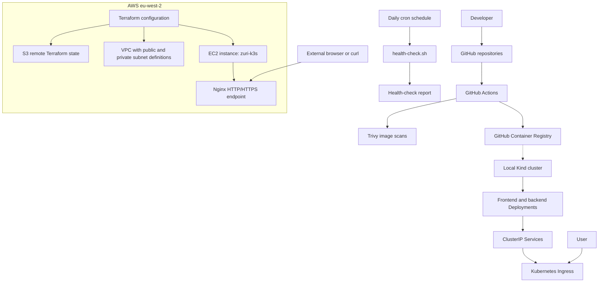

# Zuri Market — Architecture

## Overview

The platform uses GitHub for source control and CI/CD, GitHub Container Registry (GHCR) for container images, Kubernetes for application deployment, and Terraform for AWS infrastructure.

- **Local:** A Kind cluster with observed frontend and backend Deployments and Services.
- **AWS:** An EC2 instance named `zuri-k3s` responds over HTTP and HTTPS through Nginx. AWS Kubernetes workloads and the backend endpoint still need verification.

## Architecture diagram

## AWS network design

The Terraform VPC module defines a VPC with DNS support, public and private subnets, an internet gateway, a public route table with a default internet route, and a separate private route table.

The inspected private route table has no default NAT route. Terraform is configured to store state in S3 and use S3 lockfile-based state locking. Configuration alone does not prove every resource is currently deployed.

## CI/CD and container security

GitHub Actions workflows exist in the backend and frontend repositories. Evidence screenshots are stored under `docs/evidence/ci-cd/` and `docs/evidence/security/`.

Trivy screenshots document results for the specific images and runs shown. They do not prove every branch, commit, or deployed image has been scanned.

## Kubernetes

The platform repository contains Deployments, Services, ConfigMaps, an Ingress manifest, and an RBAC manifest.

The local Kind cluster has been observed with frontend and backend Deployments available. Ingress routing and AWS Kubernetes workloads still need separate runtime verification.

## Health-check automation

`scripts/health-check.sh` checks a configured health URL and appends a timestamped HEALTHY or UNHEALTHY result to a report file. The cron evidence documents a daily 09:00 schedule. Report entries should be called automated only when their execution source is confirmed.

## Monitoring

Prometheus configuration is present at `monitoring/prometheus.yml`. Successful scraping, Grafana availability, and dashboard metrics require runtime evidence before they can be described as working.

## Evidence

Supporting evidence is stored under `docs/evidence/`, including Terraform validation, CI/CD screenshots, Trivy scan screenshots, Kubernetes information, cron configuration, and health-check reports.

## Verification status

This document distinguishes infrastructure configuration from observed runtime behavior. Update it as AWS access, ingress routing, monitoring, and security checks are confirmed.
